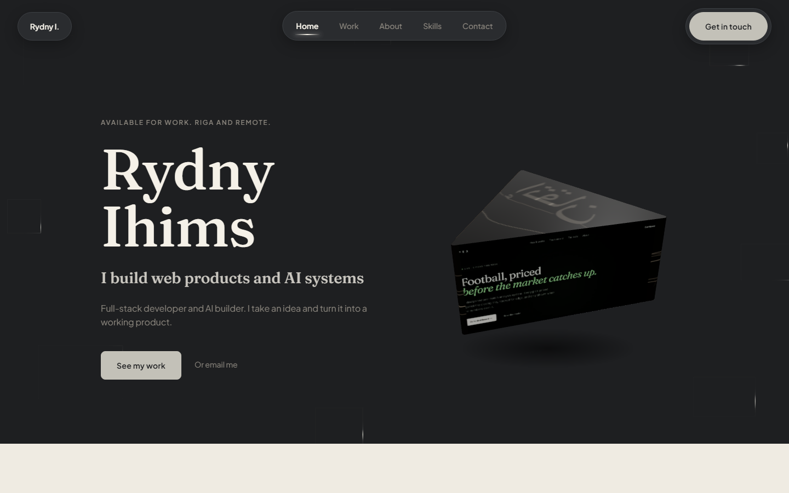

# Rydny Ihims — Portfolio

**A single page that has to do the work of a first meeting.**

[Live site](https://rydny1.github.io/Rydny-portfolio/)



It shows three things I have shipped, says who I am in a paragraph, and gets out of the way. Built for the people who decide whether to hire me, not for a general audience.

## What it is

- Hero, selected work, skills, about, contact. Nothing else.
- Work: **APEX** (an AI football-analysis engine), **ALTAYS** (a stone and furniture storefront in Dubai) and **QuickList** (a classifieds platform).
- A 3D hero scene, scroll-triggered reveals, and an Arabic typeface (Noto Naskh) used as a quiet signature.

## Built with

Astro 7 · React islands · Framer Motion · React Three Fiber · Fraunces and Plus Jakarta Sans

## Run it

Requires Node 22.12+.

```bash
npm install
npm run dev      # http://localhost:4321
npm run build    # static output in dist/
```

`CLAUDE.md` is the standing design brief for the site: the concept, the direction and the decisions made so far.

## Contact

[GitHub](https://github.com/Rydny1) · [LinkedIn](https://linkedin.com/in/rydny-ihims)
