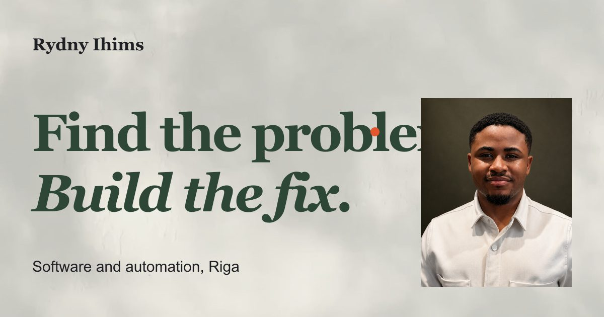

<div align="center">

# Find the problem. Build the fix.

**The portfolio of Rydny Ihims, who builds software and automations for people whose work has outgrown doing it by hand.**

[Live site](https://rydny-portfolio-v2.vercel.app) · [Projects](#the-work-on-the-site) · [Run it](#run-it-locally) · [How it is built](#how-it-is-built)



</div>

---

## What this site does in ten seconds

A visitor, whether a founder, hiring manager, client or engineer, should leave knowing one thing: Rydny finds real problems and ships working fixes. Then they should get in touch.

Everything on the page serves that. Three projects, each told as **Problem, Fix, Result**. A short list of what he fixes. A contact form written as a letter, so it takes a minute and not a meeting.

Phones decide most first impressions, so the phone layout is designed first and checked on every build.

## The concept: one quiet room in daylight

The page is a single room. Leaf shadows drift across a cream plaster wall (a looping video, paused for slow connections and reduced motion). Giant type sits on the wall. The work comes after, on paper.

One orange line runs from "Find the problem" to "Build the fix", passing four steps: **Map, Design, Automate, Test**. A single pale light travels along it. The same line continues down the page and ends at a live node in the footer.

| Element | Colour | Use |
|---|---|---|
| Wall and paper | Cream `#EEE9E3` | Main surfaces |
| Ink | `#1F2023` | Text |
| Vintage green | `#2E4636` | Headlines, the cursor leaf, active steps |
| Signal orange | `#E4572E` | The line, its nodes, full stops, the live dot |
| Night | `#161615` | Contact and footer |

Type is **Fraunces** for display and **Plus Jakarta Sans** for text, both self-hosted. No other fonts.

## The work on the site

| Project | Problem | Fix |
|---|---|---|
| **PlateShare**, 1st place, Global Challenge Hackathon | Campus canteens bin good food at closing while students go hungry | A WhatsApp bot: one message from the canteen, every student pinged, first reply claims the meal |
| **APEX** | Bookmakers misprice football matches and spotting it by hand takes hours | An engine that prices every match and flags where the bookmaker got it wrong |
| **Altays** | A Dubai marble furniture brand on a template site that undersold the product | A custom Next.js online store designed around the stone |

All project data lives in `src/content/projects.ts`. All copy lives in `src/content/copy.ts`.

## How it is built

- **Astro**, static output. TypeScript in strict mode.
- **No framework and no animation library on the page.** Motion uses the Web Animations API, CSS and small `requestAnimationFrame` loops. One scroll scheduler and one `IntersectionObserver` drive every reveal.
- **Content is in the HTML.** Scripts only start animations when an element enters view. If a script fails, the page is still complete.
- **Every animation has a settled static fallback** for `prefers-reduced-motion`, not just shorter durations.
- **Animation only touches** `transform`, `opacity`, `clip-path` and `stroke-dashoffset`. Never layout.
- **Hosted on Vercel.** The contact form posts to `api/contact.ts`, a serverless function that validates input, rejects bots (honeypot and a minimum fill time), rate-limits by IP and checks the request origin. It logs submissions today. Email delivery is not wired up yet, by decision.

### Folder map

```
src/
  components/   Hero, WhatIFix, Proof, Project, About, Contact, Nav, Fab, MiniFlow, Pic
  content/      copy.ts (all copy), projects.ts (all project data), how.ts ("How it works" bullets)
  layouts/      Base.astro (SEO tags, structured data, page shell)
  pages/        index.astro, 404.astro
  scripts/      motion, hero-wire, scroll, flows, cursor, contact, stepper, media, ui
  styles/       tokens.css (the only place colour and spacing are defined), global.css, wire.css
api/            contact.ts (Vercel function)
scripts/        build, test and measurement tools
public/         fonts, images, wall video, favicon, sitemap, robots
```

## Run it locally

You need a current Node.js LTS release.

```bash
npm install
npm run dev        # http://localhost:4321
```

| Command | What it does |
|---|---|
| `npm run dev` | Start the dev server |
| `npm run build` | Build the static site to `dist/` |
| `npm run preview` | Serve the built site |
| `npm run check` | Type-check every `.astro` and `.ts` file |
| `npm run test:gate` | Run the full test gate (see below) |

## Quality gate

`npm run test:gate` checks the built site in a real browser before anything ships:

- the hero fits the first screen across a matrix of 20+ phone, tablet, laptop and desktop sizes
- the orange line and pills land where they should after every resize
- accessibility scan with axe, and HTML validation
- the contact form and its serverless function, including bot and rate-limit cases
- gzip size budgets for JavaScript and CSS

Targets: Lighthouse accessibility, best practices and SEO at 100, JavaScript under 60 KB gzipped, CSS under 25 KB.

## Rules this project follows

- No invented claims, numbers, clients or testimonials. Where something is unconfirmed, the site leaves it out.
- No em or en dashes anywhere on the site.
- An 8px spacing scale. At least 16px from every screen edge on phones.
- Colour and spacing come from `src/styles/tokens.css` and are never hard-coded.

## Deploy

Deployed to Vercel as a static site, with `api/contact.ts` as its one serverless function. `SITE_URL` in `src/config.ts` is the single place the canonical address is set. Change it and nothing else when the final domain is bought.

## Author

Built by **Rydny Ihims**, a Computer Science student at the University of Latvia in Riga, working in English and French. Open to work.

Find him on [GitHub](https://github.com/Rydny1) or through the contact form on the [live site](https://rydny-portfolio-v2.vercel.app).
